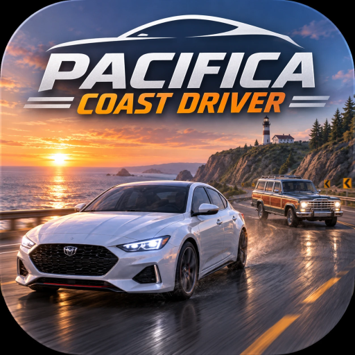

<p align="center"></p>

# Pacifica Coast Driver Mobile

Telefon için yapılmış, açık dünyalı, gerçekçi fizikli sürüş simülasyonu. Tek bir HTML dosyası olarak (tarayıcıda) ya da Android APK olarak çalışır. Hasar yoktur; amaç sürüş hissi, kokpitten okunan göstergeler, canlı trafik ve güzel bir batı kıyısı şehri.

> Geliştirme hedef cihazı: Samsung Galaxy S25+ (Snapdragon 8 Gen 3 / Elite sınıfı). S24 sınıfı cihazlar için **Orta** ayar ve dinamik çözünürlük ayarlanmıştır.

## Özellikler
- **120 Hz sabit adımlı araç fiziği:** 4 tekerlekte yük aktarımı, Pacejka benzeri lastik modeli, sürtünme elipsi, tork konvertörü, otomatik / manuel vites, ABS / TCS / ESC, 4x4 düşük vites.
- **Açık dünya:** düzensiz şehir planı, ana cadde, asma köprü, otoyol, sahil, tepe yolu, villa ve otomatik garaj kapısı, 4 ışınlanma noktası, varış görevi.
- **Yapay zekâ trafiği:** şerit takibi, şerit değiştirme, sinyal ve kırmızı ışık uyumu, kavşak rezervasyonu, kornaya yarışma.
- **15 sürülebilir araç:** gerçek araç modelleri ("Araçlar", birincil kategori), "Spor ve süper" ve "Bilim kurgu" konsept modeller; her birinde canlı kokpit, çalışan direksiyon, dönen tekerlekler, dikiz aynası, far / stop / sinyal / geri vites ışıkları.
- **Grafik:** HDR + bloom + ACES, SSAO, canlı yansımalar, gölgeler, fiziksel cam, vernikli boya, deniz kıyı köpüğü, hacimli ağaçlar, lastik izi ve duman.
- **Ana menü ve ayarlar:** videolu ana menü, ayrıntılı grafik / oynanış / arayüz / ses ayarları, otomatik kalite ayarı, FPS sınırı, dinamik çözünürlük.
- **Güncelleme bildirimi:** oyun, bu depodaki `version.json` dosyasını okur; yeni sürüm varsa ana menüde bildirir.

## Kurulum
- **APK:** [Releases](../../releases/latest) sayfasından `pacifica-coast-driver-mobile.apk` dosyasını indirip kur (Android 9+). İmzalı güncellemeler eskisinin üstüne kurulur.
- **HTML:** `pacifica-coast.zip` içindeki `pacifica-coast.html` dosyasını `data` ve `video` klasörleriyle aynı yerde tarayıcıda aç.

## Kontroller
Dokunmatik: sol tarafta direksiyon (kaydır / direksiyon / tuşlar / eğme), sağda gaz ve fren, üstte sinyaller, far, kamera ve ⋯ menüsü. Klavye: yön tuşları / WASD, Boşluk el freni, C kamera, Q/E vites, 1-4 D/N/R/P, R yola koy, Geri tuşu geri sar, T ağır çekim, L far, Z/X sinyal, H korna, G görev, Esc duraklat.

## Geliştirme
Ayrıntılar için [CLAUDE.md](CLAUDE.md) dosyasına bak.
```bash
php -S 127.0.0.1:8123        # geliştirme sunucusu → http://127.0.0.1:8123
php build.php                # dist/ (tek HTML + araç paketleri + videolar)
```
APK: `apk/build-apk.ps1` (Android SDK build-tools 36 + JDK gerekir; imza anahtarı depoda yoktur).

## Testler
- `tests.html`: yol ağı, fizik, trafik mantığı testleri (tarayıcıda aç).
- `tools/gametest.js`: sayfa içi otomatik test paketi (menü, ayarlar, grafik, her araç, trafik, FX). Oyunu açıp ana menü hazır olunca konsolda `await runAll()` çalıştır. Son rapor: [docs/TEST-RAPORU.md](docs/TEST-RAPORU.md).

## Lisans ve katkılar
Kaynak kod: MIT ([LICENSE](LICENSE)). Modeller, sesler ve dokular kendi lisanslarındadır, ayrıntı [THIRD-PARTY.md](THIRD-PARTY.md) dosyasında. **Lisans gereği bazı araç modelleri depoda yoktur**; onları nasıl ekleyeceğin de orada anlatılıyor. Oyun çıktıları marka logoları taşıyan gerçek araç modelleri içerir.
